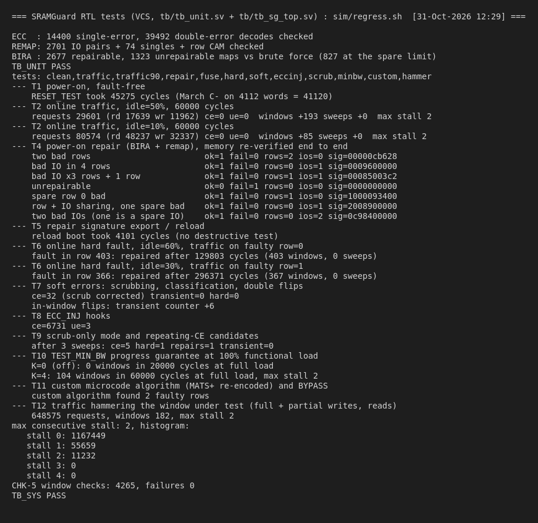
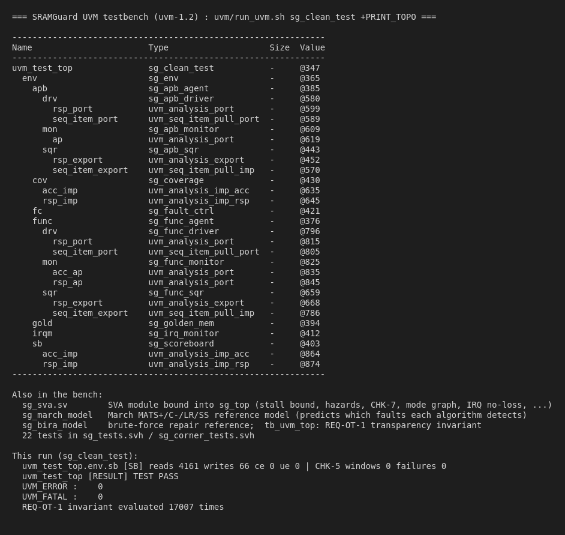
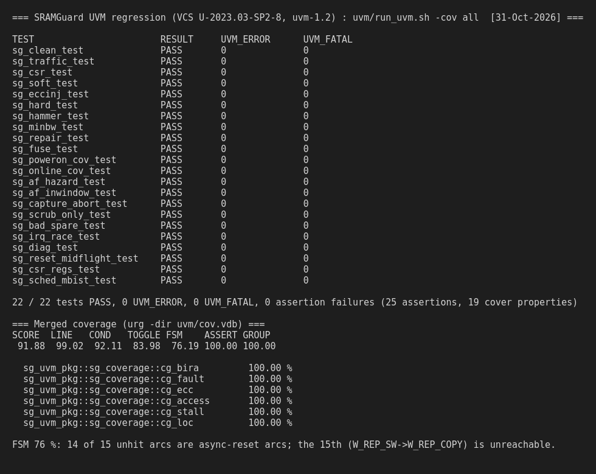
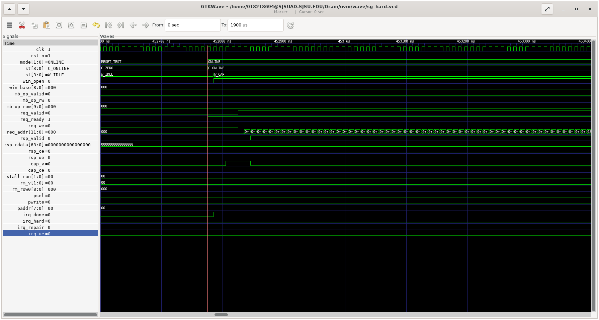
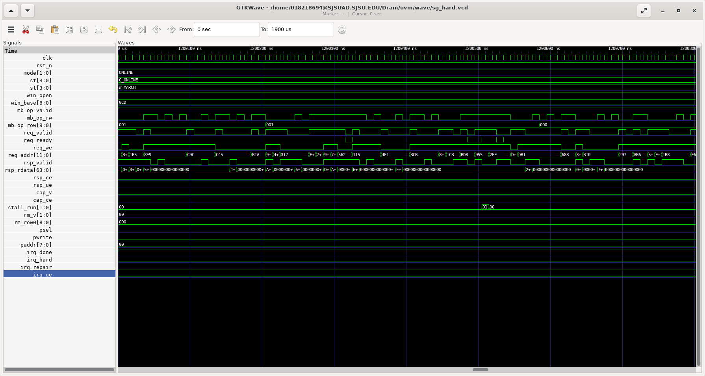
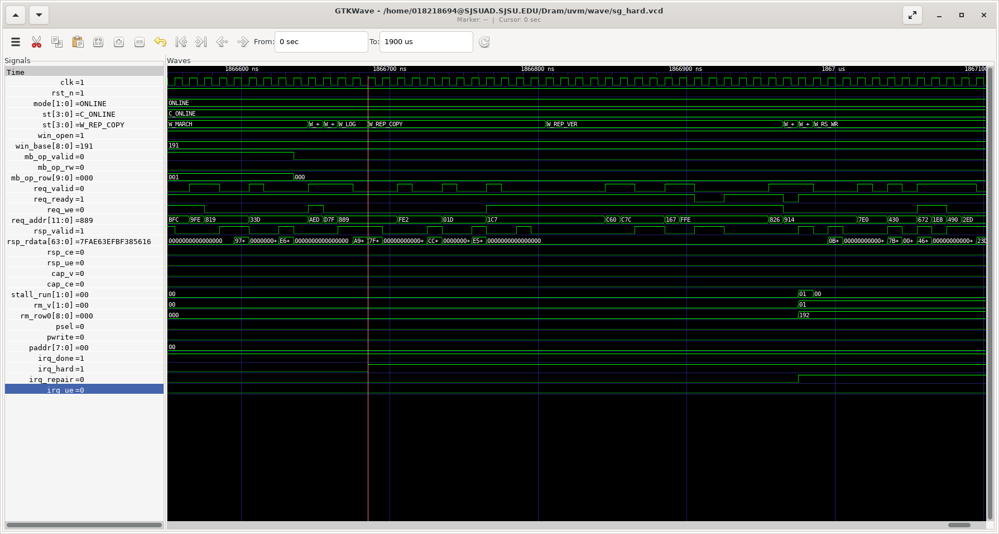
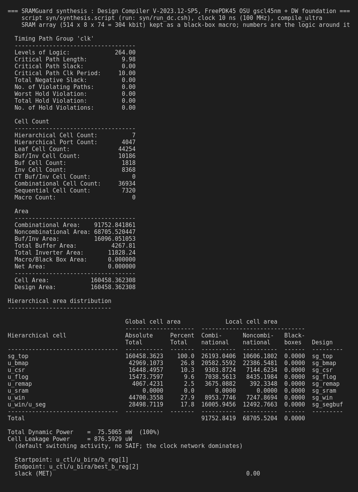

# SRAMGuard: Self-Healing SRAM
<!-- maintained by Madan Girish -->

SRAMGuard is an on-chip SRAM wrapper that handles its own testing and repair. At power-on it runs a March test across the full array, figures out the cheapest repair from whatever faults it finds, and maps bad rows and IOs onto spares — all before handing control back to the system. After that it keeps testing in the background, one small window at a time, without touching the data the application already stored. Soft errors get corrected by ECC and scrubbed; a cell that keeps failing gets its row copied to a spare while traffic keeps flowing.

The repo has the SystemVerilog RTL, a directed/random testbench, a UVM environment with SVA assertions and functional coverage, and a Design Compiler synthesis flow. Everything was simulated with Synopsys VCS and synthesized with Design Compiler on FreePDK45. Section numbers in the text refer to the *SRAMGuard Architecture Specification v0.1*.

## What's in the design

- 512 rows × 8 words per row, 64-bit data + 8-bit Hsiao SECDED code, with 2 spare rows and 2 spare IO columns (514 × 8 × 74 physical array)
- Four operating modes: RESET_TEST (power-on test and repair), ONLINE, MAINT, BYPASS
- Microcoded March engine — MATS+, March C-, March LR, March SS, plus a user-programmable algorithm slot
- Transparent online test: a segment of one row gets captured into a buffer, tested, and restored, while requests to that segment are served from the buffer. The functional port never stalls more than 2 cycles.
- Exhaustive-search BIRA at power-on; online row repair with copy, verify, and switch-over while traffic keeps running
- ECC scrubbing, repeat-CE history that escalates suspicious rows to March SS, ECC error injection, fault log, bitmap dump, APB register block, and four interrupt lines

## Repository layout

| Path | What's in it |
|---|---|
| `rtl/sg_pkg.sv`, `rtl/sg_ecc_pkg.sv` | Parameters and types; ECC matrix generated by `scripts/gen_ecc.py` |
| `rtl/sg_ecc.sv` | SECDED encoder and decoder |
| `rtl/sg_sram.sv` | The array. With `SG_SIM` defined it's a behavioural model that can inject SAF, TF, AF, CFin, CFid, CFst, IRF, RDF, DRDF, WDF and soft flips; otherwise it instantiates `sg_sram_macro` |
| `rtl/sg_remap.sv` | Spare-row CAM and IO shift muxes, repair signature |
| `rtl/sg_mbist.sv` | Microcoded March sequencer |
| `rtl/sg_flog.sv`, `rtl/sg_bira.sv`, `rtl/sg_bmap.sv` | Fault log, repair analysis, bitmap-dump FIFO |
| `rtl/sg_segbuf.sv`, `rtl/sg_scrub.sv`, `rtl/sg_win.sv` | Segment buffer, sweep scheduler, online test window and row-repair engine |
| `rtl/sg_arb.sv` | Functional port, read-modify-write, arbitration and the ECC pipeline |
| `rtl/sg_ctl.sv` | Power-on / maintenance sequencing, BIRA hand-off, zero fill |
| `rtl/sg_csr.sv`, `rtl/sg_top.sv` | APB registers and top level |
| `tb/` | `tb_unit.sv` (ECC, remap, BIRA unit tests) and `tb_sg_top.sv` (directed and constrained-random system tests) |
| `sim/` | `regress.sh` runs both testbenches; `run.sh <tests>` runs selected system tests |
| `uvm/` | UVM environment, assertions and the 22 UVM tests; `run_uvm.sh` builds and runs them |
| `syn/` | `synthesis.script` and `run_dc.csh` for Design Compiler; reports land in `syn/synth_output/` |
| `snapshots/` | Screenshots of results shown below |

## Running it

The scripts expect the Synopsys tools set up the way the SJSU lab machines have them.

```sh
sim/regress.sh                 # unit tests + directed system tests (~20 s)
sim/regress.sh full            # adds power-on coverage matrix and latency sweep

uvm/run_uvm.sh sg_hard_test    # one UVM test
uvm/run_uvm.sh all             # all 22 UVM tests
uvm/run_uvm.sh -cov all        # same, with code/FSM/toggle/assertion coverage
urg -dir uvm/cov.vdb -report uvm/urg_rpt -format text

syn/run_dc.csh                 # synthesis
```

Two switches are handy for debugging: `+DUMP_VCD=<file>` (with `+DUMP_END_NS=<ns>`) dumps key signals to a VCD, and `+PRINT_TOPO` prints the UVM component tree.

## Verification

### RTL testbench

`tb_unit.sv` checks the building blocks exhaustively or against independent references: 14,400 single-bit and 39,492 double-bit ECC errors, every pair of failing IOs through the shift muxes, and 4,000 random fault maps through BIRA against a brute-force allocator. `tb_sg_top.sv` runs the full design through power-on, traffic, power-on repair, signature reload, online hard faults, soft errors, ECC injection, scrub-only mode, the minimum test-bandwidth guarantee, a custom microcode algorithm and a traffic hammer on the window under test.



### UVM environment

Built with `-ntb_opts uvm-1.2`, following section 10.2 of the spec:

| Component | Role |
|---|---|
| `sg_func_agent` | Drives the functional port; sequences can set idle fraction, read/write/partial-write mix, address locality, a hot set, or follow the test window around |
| `sg_apb_agent` | Register reads and writes |
| `sg_fault_ctrl` | Owns the injected fault list and pushes faults into the array model |
| `sg_golden_mem` + `sg_scoreboard` | Reference memory; checks every read (CHK-1/2) and compares the full array after every window (CHK-5) |
| `sg_march_model` | Software model of the March algorithms that predicts which faults each one must catch, both at power-on and online |
| `sg_bira_model` | Brute-force repair reference |
| `sg_irq_monitor` | Every interrupt needs a cause, and is only cleared by write-1-to-clear |
| `sg_coverage` | Covergroups for access type × window state, ECC outcome × source, stall length, fault model × algorithm × mode, fault location × IO group, and BIRA outcome |



**Assertions.** `uvm/sg_sva.sv` has 25 concurrent assertions and 19 cover properties bound into `sg_top`, covering: stall limit, port protocol and response latency, read-modify-write and capture hazards, single ownership of the array, minimum test-bandwidth guarantee, window range and polarity, safe switch-over to a spare row, no access to a repaired row, legal mode transitions, interrupts that are never lost and stay set until cleared, counter freeze, and fault-log retention. The file uses no testbench state so it can be handed to a formal tool as-is. `tb_uvm_top.sv` also checks after every window cycle that the array holds exactly the original data XOR the current test polarity — that's the transparency requirement from section 6.2.

**Tests.** `sg_clean`, `sg_traffic`, `sg_csr`, `sg_csr_regs`, `sg_soft`, `sg_eccinj`, `sg_hard` (60/30/10% idle), `sg_hammer`, `sg_minbw`, `sg_repair`, `sg_fuse`, `sg_poweron_cov` (19 fault sub-models × 4 algorithms × 2 backgrounds), `sg_online_cov`, `sg_af_hazard`, `sg_af_inwindow`, `sg_capture_abort`, `sg_scrub_only`, `sg_bad_spare`, `sg_irq_race`, `sg_diag`, `sg_reset_midflight` and `sg_sched_mbist`.

### Results

All 22 UVM tests pass with no UVM errors and no assertion failures.

| Coverage | Score |
|---|---|
| Line | 99.0% |
| Condition | 92.1% |
| Toggle | 84.0% |
| Assertions and cover properties | 100% |
| Functional covergroups (all six) | 100% |
| FSM | 76.2% |

The FSM number is misleadingly low — the tool counts the async-reset transition out of every state as its own arc, and 14 of the 15 "missed" arcs are exactly that. The last one (`W_REP_SW -> W_REP_COPY`) can't actually occur because the repair request is stable before the verify pipeline drains. Every real state and transition in the window, control and BIRA machines gets hit.



A few other numbers worth knowing:

- A clean power-on test takes 45,275 cycles (41,120 for March C-, 4,096 for zero fill, 59 overhead). With a saved repair signature the boot skips the test entirely and takes 4,101 cycles.
- The March model and RTL agree on all 1,216 power-on fault injections. Online, 74 of 76 cases match exactly. The other two are DRDF faults that March C- and LR can't see — the repeat-CE history escalates them so nothing gets missed.
- A hard fault that appears just after the last window covering it closed (worst case) gets found within one sweep: 89,920–90,096 test cycles against a fault-free sweep of 89,936 plus one 176-cycle window.
- The functional port never stalled more than 2 cycles. Across the full RTL system regression (~1.23 million requests): 95% had no stall, 4.5% waited one cycle, 0.9% waited two.

### Waveforms

Screenshots from `sg_hard_test`, rendered with GTKWave from a VCD dump.

Power-on test finishing and the memory going online (RESET_TEST → ONLINE, `irq_done` fires):



Normal traffic while the background test runs a March element on the window:



A hard fault found and repaired online. The window logs the fault, copies the row to a spare, verifies it and switches over (`rm_v`, `rm_row0` = 192); `irq_hard` then `irq_repair` fire while requests keep flowing:



The full first 1.9 ms is in `snapshots/wave_1_overview.png`.

## Synthesis

Synthesized with Design Compiler V-2023.12-SP5 on the FreePDK45 OSU `gscl45nm` library with DesignWare, `compile_ultra`, 10 ns clock. The 304 kbit array is a black-box macro, so numbers are for the SRAMGuard logic only.

| | |
|---|---|
| Clock | 10 ns (100 MHz), met with zero slack, no hold violations |
| Critical path | inside the BIRA candidate search |
| Cell area | 160,458 μm² |
| Cells | 44,254 (7,320 flip-flops) |
| Largest blocks | test window + segment buffer (28%), bitmap FIFO (27%), CSRs (10%), fault log (10%) |



The max-capacitance violations DC reports are a library characterization issue with `gscl45nm` — they show up on any design synthesized with it.

### Area breakdown by feature (builds B0–B4)

Five builds with the same flow, library and constraints, array black-boxed throughout. `syn/builds/run_builds.sh` runs everything; `syn/builds/summarize.py` writes `syn/builds/results.md`. B0 and B1 are small wrappers; B2 and B3 are generated from `rtl/sg_top.sv` by `gen_builds.py` so the verified RTL is untouched. B4 is `sg_top` as-is, and its 10 ns result matches the baseline above exactly.

| Build | Cell area at 10 ns (μm²) | Step | Flip-flops |
|---|---|---|---|
| B0 bare SRAM + valid/ready | 1,304 | | 67 |
| B1 + SECDED ECC | 5,635 | +4,332 | 156 |
| B2 + power-on MBIST, BIRA, repair | 99,306 | +93,670 | 4,863 |
| B3 + scrub-only online | 157,845 | +58,540 | 7,248 |
| B4 full SRAMGuard | 160,458 | +2,613 | 7,320 |

- ECC costs about 4.3k μm², which is tiny.
- Most of B2's jump is infrastructure, not test logic: the bitmap FIFO (43.0k), fault log (15.9k), CSR block (12.4k) and remap (4.1k) account for 75.4k of the 99.3k. The MBIST sequencer, BIRA, controller and arbiter together are about 24k.
- The online engine adds 58.5k (B3 over B2), of which the segment buffer is 28.5k.
- B4 is only 1.7% bigger than B3 — the transparent March test and online repair reuse the capture, buffer and write-back path that scrub-only already needs, so enabling them costs almost nothing in area.

Pushed to a 2 ns clock (only timing matters here — area is inflated by the tighter constraint):

| Build | Critical path | Est. fmax | Limiting path |
|---|---|---|---|
| B0 | 1.30 ns | ~730 MHz | output register |
| B1 | 1.63 ns | ~585 MHz | RMW context registers |
| B2 | 6.46 ns | ~153 MHz | `u_ctl/u_bira` candidate search |
| B3 | 6.39 ns | ~155 MHz | `u_ctl/u_bira` |
| B4 | 6.57 ns | ~151 MHz | `u_ctl/u_bira` |

The spec expected ECC decode, remap or the buffer bypass to be the bottleneck. Instead BIRA limits every build that has one at around 6.5 ns — it misses 2 ns by 4.5 ns. BIRA only runs after power-on, evaluates 37 candidates, and could easily be pipelined or made multicycle; the actual functional-path limit is lower and wasn't measured here. B0/B1 numbers are for tiny designs and mostly say "much faster". These are DC estimates with ideal clocks and no wire delay, not PrimeTime.

B1 was checked with a quick smoke test (5,269 mixed requests, 2,009 reads against a memory model, no mismatches); B0 was only elaborated and synthesized.

### Latency and throughput: B4 vs B1 (experiment E4)

Same 20,000-request stream (50% reads, 25% full writes, 25% partial writes, random addresses) through B1 (SRAM + ECC) and B4 (full SRAMGuard). Script: `syn/builds/run_e4.sh`, raw output: `syn/builds/e4_results.txt`.

| Load (idle %) | TEST_MIN_BW | B1 req/cycle | B4 req/cycle | Max read latency B1 / B4 | Max stall B1 / B4 | B4 windows |
|---|---|---|---|---|---|---|
| 0 | 0 (off) | 0.662 | 0.756 | 2 / 2 | 2 / 2 | 0 |
| 0 | 16 | 0.662 | 0.717 | 2 / 2 | 2 / 2 | 10 |
| 50 | 0 | 0.429 | 0.458 | 2 / 2 | 2 / 2 | 85 |
| 90 | 0 | 0.099 | 0.099 | 2 / 2 | 2 / 2 | 934 |

- Read latency is 2 cycles in both builds; the online engine adds nothing to read latency.
- At 100% load with `TEST_MIN_BW` off (the reset default), no test window runs — by design. With `TEST_MIN_BW=16`, 10 windows completed in ~28k cycles and throughput dropped 5% (0.756 to 0.717).
- B4 shows higher throughput than B1 because my B1 wrapper handles a partial write with a 2-cycle RMW stall while the full design does it in ~1 cycle. That's a wrapper implementation detail, not the test engine making things faster.
- All reads matched the model, zero errors. Single stream, one seed.

### Power with real switching activity (experiment E6)

RTL SAIF from VCS (`syn/builds/run_e6_sim.sh`, request phase only, 100 MHz) back-annotated into Design Compiler (`syn/builds/run_e6_dc.sh`), same 20,000-request stream as E4. `report_power`, FreePDK45, 10 ns. SRAM array is black-boxed so **array power is not included**.

| Build, load | Leakage | Logic dynamic (register + combinational) | Clock network (pre-CTS estimate) |
|---|---|---|---|
| B1, 50% idle | 0.033 mW | 0.24 mW | 0.54 mW |
| B1, 100% load | 0.033 mW | 0.28 mW | 0.57 mW |
| B4, 50% idle | 0.88 mW | 2.02 mW | 75.2 mW |
| B4, 100% load, `TEST_MIN_BW`=16 | 0.88 mW | 1.95 mW | 75.2 mW |

- Leakage and logic dynamic are the useful numbers: B4 costs ~26× the leakage and ~8× the logic dynamic of B1, roughly in line with its 28× area.
- The online test engine is not a power hog — B4's logic power is about the same at 100% load (few windows) as at 50% idle (many windows).
- The 75 mW clock network figure is an extrapolation artifact; there's no clock tree, so DC guesses a wire load across ~7,300 flops. Ignore it — it needs place-and-route and CTS.
- SAIF covers 21% of nets directly (B1: 29%); DC propagates activity to the rest. The RTL-to-gate name mapping is incomplete, so treat the logic numbers as ±tens of percent.
- DC estimates, not PrimeTime PX. Single traffic stream.

## Bugs found during verification

1. **Test window starved by a hot address (section 6.5).** To avoid stacking a forced test slot on top of a capture wait, the arbiter was skipping the forced slot whenever the request targeted the word the window was waiting for. A stream aimed at that word could nearly stop the background test: 1 window in 40,000 cycles with `TEST_MIN_BW = 4`. Fixed so the forced slot always wins; a write to a pending word is accepted in the cycle its capture data returns, keeping the worst-case stall at 2. The same stream now gets 58 windows. Found by `sg_minbw_test` and `a_min_bw_progress`.

2. **Lost interrupt.** An interrupt raised in the same cycle as a write-1-to-clear of `IRQ_STAT` was wiped out with the old bits. Fixed to `(irq_stat & ~w) | irq_set`. Found by `a_irq_no_loss`.

3. **Transparency broken by a decoder fault inside the window.** The test's own writes to the victim address also landed on the alias word in the same window, and the fault was classified as transient because the mismatch pattern differed between the two test runs. A restore pass now follows any window that saw a mismatch: rewrite from the buffer, read back, fix whatever differs. Clean windows don't pay for it. With 16 such faults injected there are now 0 data errors, versus 15 before.

4. **No hard-fault interrupt for offline detections.** Section 9.3 requires `irq_hard` on faults found offline as well as online; the power-on and maintenance paths now raise it and bump the counter.

5. **Repair-kind classification in the testbench.** The BIRA reference was returning the first repair it found instead of the cheapest one, making the rows-only coverage bin unreachable. Fixed to return the minimum-cost repair — the same rule as the RTL — and the repair test now checks the DUT's choice directly.

## What the tests showed about the spec

- The spec lists MATS+ as covering address faults. With the alias-write fault model from section 4.3 it catches 14 of 16; the March model predicts the same two misses. March C-, LR and SS catch all sixteen.
- DRDF is invisible to March C- and LR, but a DRDF cell keeps producing correctable errors so the repeat-CE escalation from section 7.4 finds it in the second sweep.
- A decoder fault whose alias lies in a neighbouring row outside the current window can overwrite that word with a valid codeword, and nothing can detect that. This is the residual risk the spec describes in section 6.6; `sg_af_hazard_test` measures it.

## Design decisions worth noting

- The microcode ROM has 21 elements (3 + 6 + 6 + 6). The spec says 24, which doesn't match its own algorithm table.
- The background formula in section 5.3, `(8b + c) mod 2`, reduces to `c mod 2`, so every IO of a word gets the same value. It's implemented as written.
- The must-repair rules aren't separate logic — the exhaustive search always finds an optimal repair, which already covers them.
- While a row is being migrated online, functional writes go to the buffer and the spare row only; reads of the old row are served from the buffer. An earlier scheme that re-copied the row livelocked under heavy traffic to that row.
- The 2-cycle stall budget covers partial-write and capture-pending waits; the arbiter holds back a forced test slot when it would push a request past that.
- Decoder faults are flagged at capture time when 4 or more different bit positions need correction in one capture (`DF_TH`). A stuck IO, which shows up in one or two positions, is deliberately not treated as a decoder fault.
- SECDED can miscorrect some triple-bit errors — that's a property of the code, and the testbench avoids creating them.
- Registers added beyond the spec's table: `CTRL.FREEZE`, `FLOG_SEL`, `IRQ_STAT` (0xC0, W1C), `UC_IDX`/`UC_DATA` for the microcode RAM, the bitmap FIFO `BM_STAT`/`BM_DATA` (0xD0–0xDC), and counter 13 for windows aborted on a decoder-fault pattern.
- `fuse_vld`/`fuse_sig` model a saved repair signature. When present, RESET_TEST skips the destructive test and only zero-fills the array.
- The 17 remaining lint warnings are width mismatches in the simulation-only fault model in `sg_sram.sv`; the synthesizable RTL is lint-clean.
